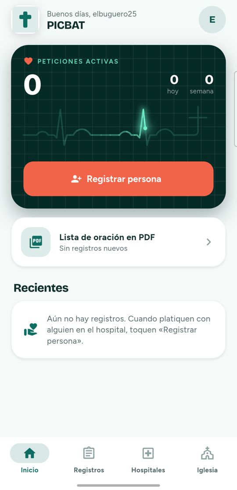
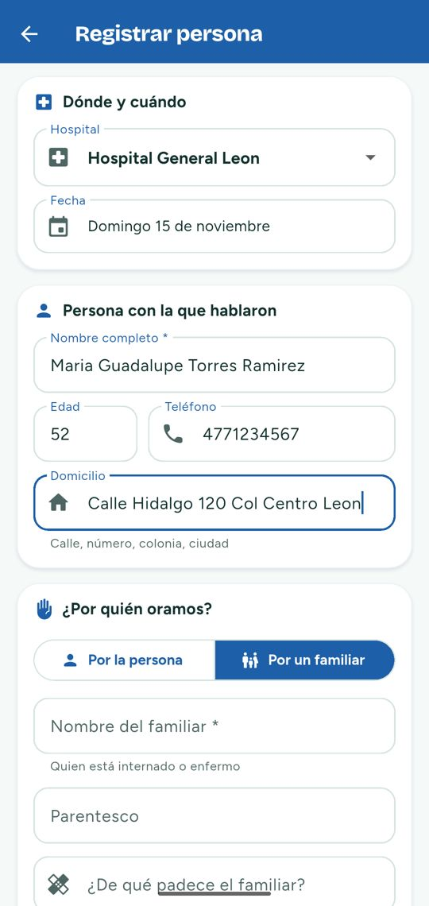
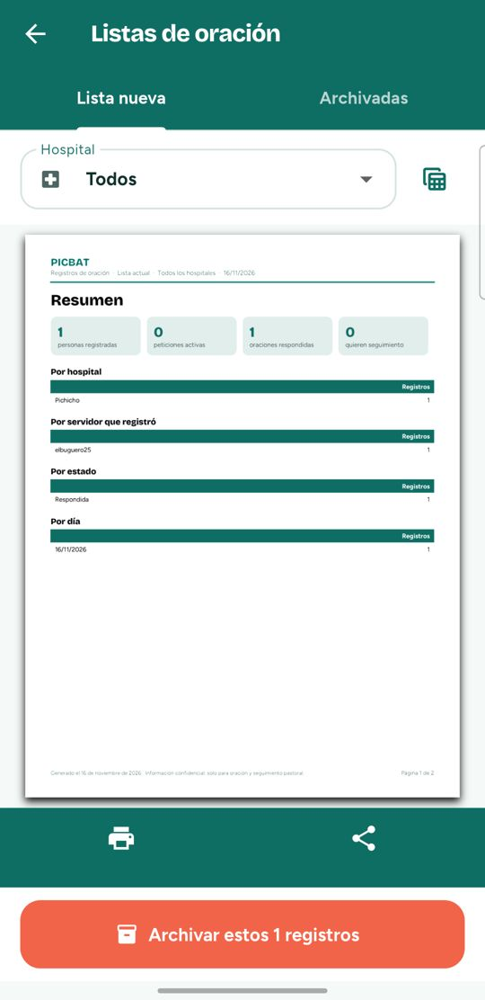
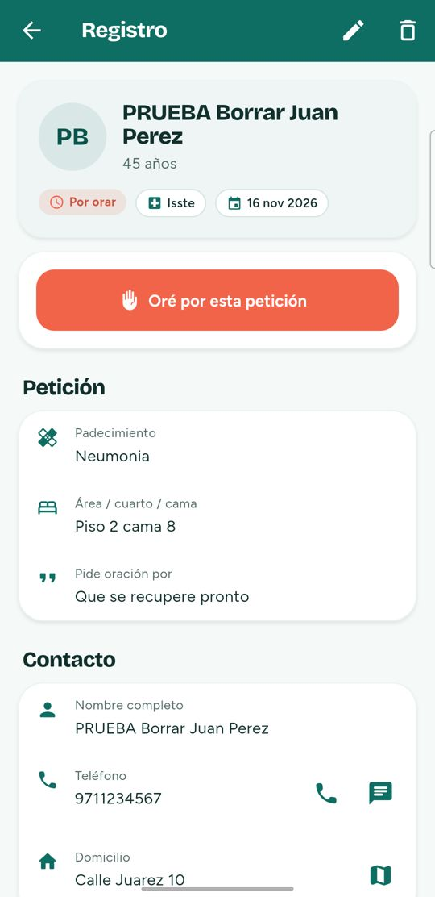
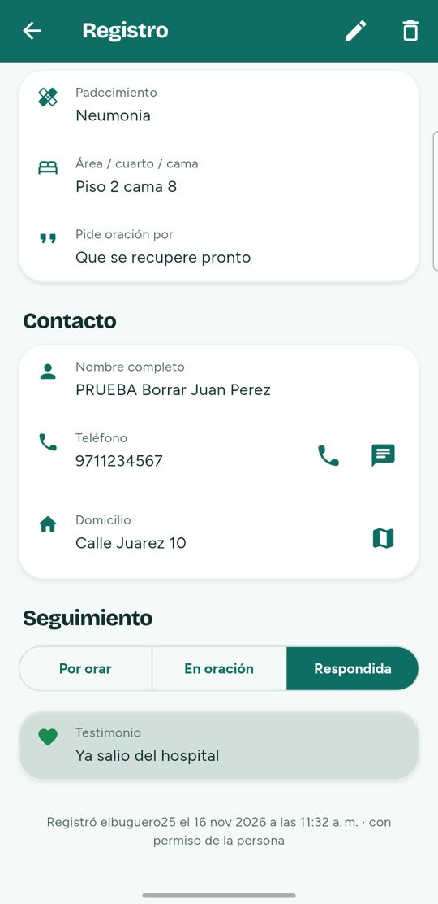
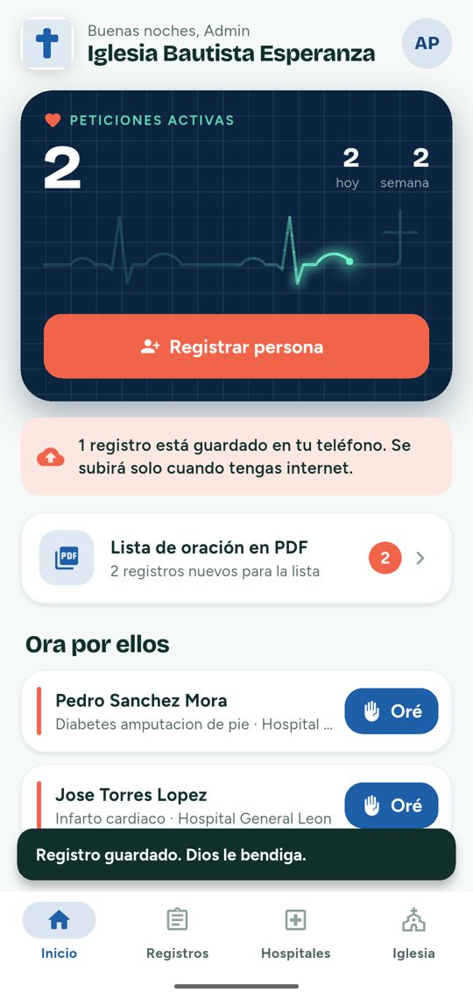

<p align="center">
  
</p>

<h1 align="center">Visitas de Fe</h1>

<p align="center">
  App Android para que las iglesias que visitan hospitales registren a las personas por las que van a orar, aunque no haya señal.
</p>

<p align="center">
  <a href="https://github.com/Jean1722343/visitas-de-fe/releases/latest"><b>Descargar la última versión</b></a>
</p>

<p align="center">
  
  
  
</p>

> «Estuve enfermo, y me visitasteis» — Mateo 25:36

## Por qué existe

En mi iglesia salimos a visitar hospitales. Llegamos, regalamos café y pan a quienes están esperando afuera o acompañando a un enfermo, platicamos con ellos y, si quieren, oramos por ellos o por su familiar internado. Para no olvidar a nadie, anotábamos sus datos en unas tablas de papel: nombre completo, teléfono, domicilio, de qué padece, en qué hospital estaba y por quién pedía oración.

El problema era el papel. Algunas hojas se perdían, otras se llenaban con prisa y luego nadie entendía la letra, y juntar las de todos para orar por cada persona en la reunión era un trabajo aparte. Una persona que nos pidió oración podía quedarse fuera de la lista sin que nadie se diera cuenta.

Esta app nació para resolver eso. Cada servidor anota a la persona en su celular en menos de un minuto, aunque dentro del hospital no haya señal; los datos se suben solos al salir. El administrador saca la lista de oración en PDF, con todo en tablas, y la archiva para que la siguiente empiece desde cero. Está hecha para que cualquier iglesia la pueda usar: alguien la registra, da de alta los hospitales que visitan e invita a los demás con un código.

## Qué hace

| | |
|---|---|
| **Registrar persona** | Nombre completo, edad, teléfono, domicilio, de qué padece, área o cama, y la petición de oración. Si se ora por un familiar internado, también su nombre y parentesco. Con *Guardar y registrar otra* se capturan varias personas seguidas, y la app recuerda el último hospital. |
| **Sin señal** | Todo se guarda en el teléfono y se sube solo al volver la conexión. Los registros pendientes muestran una nube tachada y el inicio avisa cuántos faltan por subir. |
| **Orar y dar seguimiento** | Botón *Oré por esta petición* (queda quién oró), estados *Por orar → En oración → Respondida* con el testimonio de cómo respondió Dios. Llamada, WhatsApp y mapa desde cada registro. |
| **Lista de oración en PDF** | El administrador saca la lista con todo lo registrado desde la última vez: una hoja de resumen (por hospital, por servidor, por estado y por día) y la tabla completa, con el logo de la iglesia. Al **archivarla**, esos registros ya no salen en la siguiente. Las listas anteriores quedan en *Archivadas* para volver a descargarlas, y se puede deshacer. También en Excel. |
| **Hospitales** | Cada iglesia define los hospitales que visita, con dirección, teléfono y notas para los servidores (horario de visita, por dónde entrar). |
| **Búsqueda** | Por nombre, padecimiento o teléfono, sin importar acentos. Filtros por estado, hospital, «míos» y «con seguimiento». |
| **Unirse por código** | Un código de 6 letras que vale 7 días. Se comparte por WhatsApp con el enlace de descarga. |
| **Personalización** | Cada iglesia sube su logo y elige su color: toda la app se pinta de ese color. Cada usuario pone su nombre y su foto. |
| **Se actualiza sola** | Al abrir la app revisa si hay versión nueva, la descarga (unos 23 MB, solo la de su tipo de celular, y sigue donde se quedó si se corta la señal) y abre el instalador. |

<p align="center">
  
  
  
  
</p>

## Quién puede hacer qué

- **Administrador.** Quien registra la iglesia. Da de alta los hospitales, personaliza la iglesia, invita y nombra a otros administradores, quita o desactiva miembros, ve qué registró cada quien, saca y archiva la lista en PDF y puede borrar cualquier registro.
- **Servidor.** Entra con un código. Registra a las personas por las que hay que orar, ve y busca los registros de su iglesia, marca que oró, cambia el estado, invita a otros servidores y borra solo lo que él registró.

La iglesia nunca se queda sin administrador: la app no deja quitar al último. Estas reglas no dependen de la app: están en `firestore.rules` y las hace cumplir el servidor, así que nadie de otra iglesia puede ver sus datos.

## Instalar

1. En el celular, abre [la última versión](https://github.com/Jean1722343/visitas-de-fe/releases/latest) y descarga **visitas-de-fe-arm64-v8a.apk** (sirve en casi todos los celulares; en uno antiguo de 32 bits, **visitas-de-fe-armeabi-v7a.apk**).
2. Ábrelo y activa **«Permitir de esta fuente»** cuando Android lo pida.
3. Si aparece Google Play Protect, elige analizar la app o instalar sin analizar: sale porque la app no viene de Play Store.
4. Entra con Google o con tu correo y toca **Tengo un código**, o **Registrar mi iglesia** si eres quien coordina las visitas.

## Cómo está hecha

- **Flutter** (Android), con Riverpod para el estado. Misma base que [Embajadores del Rey](https://github.com/Jean1722343/embajadores-del-rey).
- **Firebase en el plan gratuito**: Auth (correo y Google) y Cloud Firestore con caché local ilimitada. No usa Storage ni Cloud Functions: el logo y las fotos de perfil se reducen en el teléfono y se guardan dentro de Firestore.
- **Sin señal.** Las escrituras no esperan al servidor: quedan en el teléfono y Firestore las sube solas.
- **PDF en el teléfono**, con el paquete `pdf` y las fuentes de la app incluidas, para que los acentos salgan bien.
- **Actualizaciones** por GitHub Releases: la app consulta el último release, elige el APK de su procesador, lo descarga en su carpeta privada (no en la caché, que Android vacía cuando falta espacio), reanuda si se corta y abre el instalador con un `FileProvider` (`MainActivity.kt`).
- **Diseño.** Verde quirófano y coral; el motivo es un monitor cardíaco cuya línea sube y se convierte en cruz. Cada iglesia cambia el color principal. Tipografías Bricolage Grotesque y Figtree, incluidas en la app.

```
lib/
  core/       tema (color por iglesia), comparación de versiones
  models/     iglesia, miembro, invitación, hospital, registro, lista archivada
  services/   Firebase (repo), estado, fotos, PDF, Excel, actualizaciones
  features/   pantallas
  widgets/    componentes compartidos y el monitor cardíaco
firestore.rules   quién puede leer y escribir cada cosa
publicar.ps1      publica una versión nueva
test/             versiones, elección del APK, búsqueda y PDF
```

## Ponerla a funcionar

Necesitas Flutter 3.50 o más reciente, Node y la CLI de Firebase.

1. Crea un proyecto en [Firebase](https://console.firebase.google.com/) y activa **Authentication** (correo y Google) y **Firestore**.
2. Conecta la app. Esto genera `lib/firebase_options.dart` y `android/app/google-services.json`, que no están en el repositorio:
   ```
   dart pub global activate flutterfire_cli
   flutterfire configure --platforms=android
   ```
3. Publica las reglas: `firebase deploy --only firestore:rules`
4. Para entrar con Google, registra en Firebase las huellas SHA-1 y SHA-256 de tu llave de firma.
5. Corre o compila: `flutter run` · `flutter build apk --release --split-per-abi`

## Publicar una versión nueva

```
.\publicar.ps1 1.0.4 "Qué cambió"
```

Sube la versión en `pubspec.yaml`, corre las pruebas, compila un APK firmado por tipo de procesador, sube los cambios y crea el release en GitHub. Al abrir la app, cada celular descarga el suyo y abre el instalador.

**La llave de firma** (`android/app/visitas-de-fe.jks` y `android/key.properties`) no se sube al repositorio. Respáldala: Android solo instala una actualización encima si está firmada con la misma llave.

## Pruebas

```
flutter test
```

Revisan la comparación de versiones, que cada celular elija el APK de su procesador, la búsqueda sin acentos, el teléfono para WhatsApp y que el PDF se genere con acentos.

## Privacidad

La app guarda datos de salud y de contacto de personas en un momento difícil. Antes de guardar, el formulario exige confirmar que la persona aceptó. Solo los miembros de su iglesia los ven, y el administrador puede borrarlos. Son para orar y dar seguimiento pastoral, nada más.

## Créditos

Hecho por **Jean Paul Gallegos Cruz** — [LinkedIn](https://www.linkedin.com/in/jeanpaulgc).

Para las iglesias que visitan a los enfermos. *«Estuve enfermo, y me visitasteis»*, Mateo 25:36.
